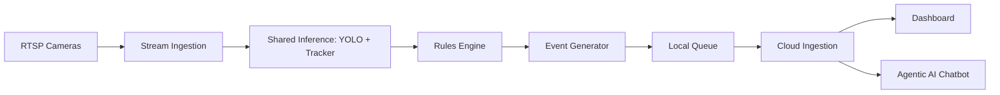
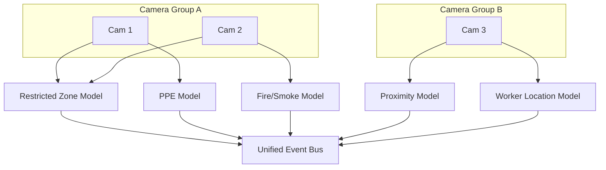

# Beginner Documentation: Edge AI and Edge Computing Architecture

## 1. What Is Edge Computing?

Edge computing means processing data close to where data is generated instead of sending everything to a far cloud first.

In this project, data is generated by IP cameras (RTSP streams). Instead of sending full video to cloud for every decision, a nearby small server (edge server) processes video and sends only events and alerts.

Simple idea:
- Camera captures scene
- Edge server understands scene
- Cloud receives compact events, dashboards, and reports

## 2. What Is Edge AI?

Edge AI is running AI models on edge devices (local servers near cameras) for fast, local decisions.

For our use case, Edge AI means:
- Run detection/tracking models near the factory floor
- Trigger safety alerts quickly
- Continue working even if internet is unstable

## 3. Why We Need Edge AI In This Project

Our project is safety-focused and camera-only. Safety alerts must be fast and reliable.

Main reasons:
1. Low latency: dangerous event alerts should happen in seconds, not after cloud delay.
2. Outage tolerance: internet loss should not stop local safety monitoring.
3. Bandwidth efficiency: sending events is cheaper than sending full multi-camera video all the time.
4. Privacy control: less raw video movement across networks.

## 4. Project Goal (Architecture View)

Build a modular platform where we can:
1. Group or select cameras flexibly.
2. Assign one model or multiple models per camera/group.
3. Produce unified events for dashboard, alerts, and AI chatbot.
4. Scale from small pilot to larger deployments without redesign.

## 5. Core Architecture Overview

### 5.1 Physical Layers

1. Camera Layer:
   - Existing IP/CCTV cameras
   - Streams over RTSP

2. Edge Layer:
   - Small server per zone/floor/building
   - Runs ingestion, AI inference, rules, and local queue

3. Cloud Layer:
   - Event storage, analytics, reporting, chatbot
   - Model/version governance

### 5.2 Logical Pipeline

```text
Camera Streams
  -> Stream Ingestion
  -> Shared Inference (detector + tracker)
  -> Service Rules Engine
  -> Event Generator
  -> Local Queue (offline-safe)
  -> Cloud Sync
  -> Dashboard + Agentic AI Chatbot
```

## 5.3 Diagram Formats (Mermaid + PlantUML)

This documentation supports both Mermaid and PlantUML.

Use Mermaid when:
1. You want diagrams visible directly inside markdown files.
2. You want fast edits during discussions.

Use PlantUML when:
1. You want stable architecture source files in `diagrams/`.
2. You want consistent exported outputs (PNG/SVG) for reports and slides.

Current PlantUML sources:
1. `diagrams/edge_ai_high_level.puml`
2. `diagrams/edge_ai_deployment_topology.puml`
3. `diagrams/edge_ai_camera_data_flow.puml`

Recommended output path for rendered diagrams:
1. `assets/edge_ai_high_level.png`
2. `assets/edge_ai_deployment_topology.png`
3. `assets/edge_ai_camera_data_flow.png`

### Mermaid: High-Level Flow



### Mermaid: Multi-Model Assignment View



   ### Camera -> Edge -> Cloud Data Flow

   ```mermaid
   flowchart LR
      subgraph CAMS[Camera Layer]
         C1[Camera Streams\nRTSP video]
         C2[Camera Metadata\nID, location, zone]
      end

      subgraph EDGE[Edge Device / Small Server]
         E1[Decode + Sample Frames]
         E2[Run Models\nYOLO, PPE, Fire/Smoke, Proximity]
         E3[Track Objects\nByteTrack]
         E4[Apply Rules\nZones, schedules, thresholds]
         E5[Create Events\nJSON alerts, snapshots, counts]
         E6[Local Queue\nOffline buffer]
      end

      subgraph CLOUD[Cloud / Central Server]
         CL1[Store Events]
         CL2[Dashboards + Reports]
         CL3[Agentic AI Chatbot]
         CL4[Model Registry + Monitoring]
      end

      C1 --> E1
      C2 --> E1
      E1 --> E2
      E2 --> E3
      E3 --> E4
      E4 --> E5
      E5 --> E6
      E6 --> CL1
      CL1 --> CL2
      CL1 --> CL3
      CL4 --> E2
   ```

   ### What Each Layer Computes and Shares

   | Layer | Computes | Shares |
   |---|---|---|
   | Cameras | Video frames and basic stream metadata | RTSP streams, camera ID, location, zone info |
   | Edge devices | Detection, tracking, zone checking, alert logic | Structured events, snapshots, counts, local alerts |
   | Cloud / centralized server | Aggregation, reporting, long-term analytics, chatbot responses | Dashboards, reports, event history, model/version control |

   Simple rule:
   - Cameras send video.
   - Edge computes decisions.
   - Cloud stores and explains results.

   This is the exact division of work for the project: compute as much as possible near the cameras, then share only meaningful events upward.

## 6. Modular Design (Most Important Requirement)

This project must be modular, not fixed. That means we can change camera-model assignments without rewriting core code.

### 6.1 Modular Unit Definitions

1. Camera Unit:
   - One camera stream with metadata (location, risk level, schedule)

2. Camera Group Unit:
   - Collection of cameras (for example: Welding Area, Loading Zone)

3. Model Unit:
   - AI model or service model profile (for example: PPE, Fire/Smoke, Restricted Zone)

4. Assignment Unit:
   - Mapping between cameras/camera groups and model(s)

### 6.2 Assignment Flexibility

Architecture must support:
1. One camera -> one model
2. One camera -> multiple models
3. Camera group -> one shared model set
4. Camera group -> custom per-camera model set

## 7. Can We Run Multiple Models On The Same Camera Stream?

Yes. This is a core supported pattern.

Recommended method:
1. Decode stream once.
2. Reuse frames for multiple model/rule paths.
3. Merge outputs into one event bus.

Why this is best:
1. Reduces duplicate decode load.
2. Saves GPU/CPU resources.
3. Makes synchronization easier between services.

## 8. Model Strategy For This Project

Use a shared baseline for performance, then add service-specific logic.

Recommended strategy:
1. Shared detector + tracker baseline
   - Detector (YOLO family)
   - Tracker (ByteTrack)
2. Service-specific rule heads
   - Restricted zone logic
   - PPE compliance logic
   - Fire/smoke logic
   - Proximity risk logic

This avoids running many heavy independent models unnecessarily.

## 9. Architecture Options And When To Use Them

### 9.1 Option A: Edge-Heavy (Primary for this project)

Use when:
1. Real-time safety alerts are required.
2. Internet may be unstable.
3. Local autonomy is important.

### 9.2 Option B: Hybrid Burst (Secondary)

Use when:
1. Critical services remain on edge.
2. Some optional/heavy processing can move to cloud.
3. You need flexibility under load.

### 9.3 Option C: Cloud-First (Research/prototype only)

Use when:
1. Fast central experimentation is needed.
2. Safety-critical local autonomy is not required.

Not recommended as the primary safety path for this project.

## 10. How We Will Use Edge Computing In This Project

### 10.1 Deployment Intent

1. Cameras stay as data sources only.
2. Each edge server handles a group of cameras.
3. Critical alerts are generated locally.
4. Cloud receives events and provides analytics/chatbot.

### 10.2 Suggested Initial Grouping

Start simple and benchmark-based:
1. Pilot edge node for 4 cameras
2. Expand to 8 cameras
3. Test up to 12 cameras only after pass criteria

Final capacity is accepted only by benchmark results, not guesses.

### 10.3 Critical Service Placement

Always edge-local first:
1. Restricted zone enforcement
2. Fire/smoke alerting
3. Proximity/high-risk alerts

Edge-preferred with dynamic sampling:
1. PPE compliance
2. Worker location zones

Cloud-first support services:
1. Dashboard analytics aggregation
2. AI chatbot report generation and Q&A

## 11. Runtime Modes (How The System Behaves)

### 11.1 Normal Mode

1. Edge processes video.
2. Alerts are generated and sent locally.
3. Events sync to cloud continuously.

### 11.2 Degraded Mode (Internet Problems)

1. Edge keeps processing and alerting.
2. Events are stored in local queue.
3. No safety stop because cloud is unreachable.

### 11.3 Recovery Mode

1. Connection returns.
2. Queue replays events to cloud.
3. Duplicate checks ensure clean state.

## 12. Beginner Start Plan (Step-by-Step)

### Step 1: Define Pilot Scope

1. Choose 2-3 critical services.
2. Choose 4 pilot cameras from different conditions.
3. Define expected alert behavior for each camera.

### Step 2: Set Baseline Stack

1. Detector candidate A (nano profile)
2. Detector candidate B (medium profile)
3. Tracker baseline (ByteTrack)
4. Shared event schema fields

### Step 3: Implement Camera-Model Assignment Config

Create configuration that maps:
1. Camera IDs -> model profiles
2. Group IDs -> model profiles
3. Priority levels and frame sampling policy

### Step 4: Run Benchmarks

Minimum matrix:
1. Camera counts: 1, 4, 8, 12
2. Sampling FPS: 3, 5, 8
3. Conditions: daylight, low light, occlusion

### Step 5: Run Failure Tests

1. Internet outage (5, 15, 30 min)
2. Cloud ingestion unavailable
3. Edge process restart under load
4. Camera disconnect/reconnect

### Step 6: Finalize Architecture Decision

1. Choose final camera-per-edge sizing
2. Choose default model profiles
3. Freeze assignment policy
4. Update PlantUML diagrams

## 13. Benchmark Metrics (Must Track)

Performance:
1. Inference latency p50/p95/p99
2. End-to-alert latency
3. Sustained FPS per stream
4. CPU/GPU/memory usage

Reliability:
1. Emitted vs acknowledged events
2. Dropped events
3. Retried events
4. Duplicate events after recovery

AI quality:
1. Precision
2. Recall
3. F1
4. False alert rate for critical classes

## 14. Pass Criteria (Initial)

1. Edge inference + rules p95 <= 300 ms
2. End-to-alert p95 <= 2 s
3. Outage event loss = 0
4. Critical recall >= 0.90

These values are starting targets and can be revised after first benchmark cycle with evidence.

## 15. Example Configuration Pattern (Beginner-Friendly)

Use this as architecture guidance for camera-model mapping.

```yaml
edge_node_id: edge-zone-a-01

cameras:
  - id: cam-entrance-01
    group: zone-entrance
    resolution: 1080p
    models: [restricted_zone, ppe]
    sample_fps: 5

  - id: cam-forklift-02
    group: zone-logistics
    resolution: 720p
    models: [proximity, worker_location, fire_smoke]
    sample_fps: 8

groups:
  - id: zone-entrance
    default_models: [restricted_zone]

  - id: zone-logistics
    default_models: [proximity, fire_smoke]

model_profiles:
  restricted_zone:
    priority: critical
    min_confidence: 0.55

  ppe:
    priority: medium
    min_confidence: 0.60

  fire_smoke:
    priority: critical
    min_confidence: 0.50
```

Notes:
1. `models` allows one or multiple models per camera.
2. Group defaults reduce repeated per-camera setup.
3. Priority controls scheduling under heavy load.

## 16. Documentation Rules For Team

Every architecture change must update:
1. This README (decision + reason + evidence)
2. PlantUML diagrams in `diagrams/`
3. Mermaid snippets in this README if architecture flow changed
4. Benchmark evidence table for changed behavior

If it is not documented, it is not accepted as final architecture.

## 17. Team Roles (1 AI + 5 Software)

1. AI engineer:
   - model benchmarking, threshold tuning, quality analysis
2. Software engineer A:
   - stream ingestion and decode pipeline
3. Software engineer B:
   - assignment engine (camera/group -> model mapping)
4. Software engineer C:
   - rules engine and event schema pipeline
5. Software engineer D:
   - queue, sync, outage reliability
6. Software engineer E:
   - observability, documentation, and diagram maintenance

## 18. Glossary (Beginner)

1. Edge server: Local compute server near cameras.
2. RTSP: Network protocol for camera video streams.
3. Inference: Running a trained model to predict objects/events.
4. Tracker: Keeps identity of objects across frames.
5. Event schema: Standard fields describing alerts/events.
6. p95 latency: Value under which 95 percent of requests complete.
7. Recall: How many true dangerous events are correctly detected.

## 19. Final Architecture Recommendation For This Project

1. Use Edge-Heavy as default architecture.
2. Keep Hybrid Burst as controlled extension.
3. Use Cloud-First only for research/prototyping tasks.
4. Keep modular camera/group-to-model assignment as first-class design requirement.

This directly supports your core requirement:
- Select any single camera or camera group.
- Attach any one model or multiple models.
- Preserve low-latency safety behavior and reliable event flow.
