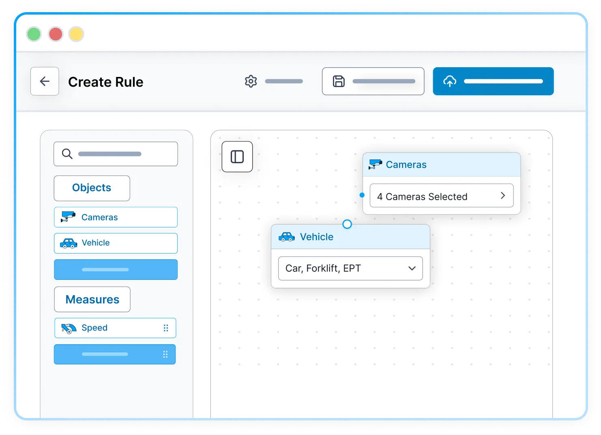

# Protex AI — Deep Dive

*Companion to the [Protex AI section in the market providers overview](README.md). See also [`../egypt_market.md`](../../egypt_market.md).*

| | |
|---|---|
| **HQ** | Dublin, Ireland (EU HQ, 42 Westland Row) — offices in Boston, USA & London, UK |
| **Founded** | 2021, by Dan Hobbs (CEO) and Ciarán O'Mara (CTO) |
| **Funding** | $54M raised (Seed 2021, Series A 2022, Series B $36M) |
| **Team** | 60+ employees |
| **Website** | [protex.ai](https://www.protex.ai) |
| **Security** | ISO/IEC 27001:2022 certified |
| **Recognition** | Ranked highest in the Verdantix 2026 Video Analytics report |

## Positioning

Protex AI positions itself as the **"site intelligence and observability layer"** for industrial operations — not a CCTV tool. It turns the cameras a site already owns into a continuous observer of the physical floor, fusing video with enterprise systems (WMS, MES, TMS, EHS, CMMS, ERP) so EHS and operations teams can see how work is actually done and act before issues become incidents. The platform follows a three-step model:

1. **Connect** — plugs into existing CCTV via RTSP through an on-site edge device (video processed on-premise; for a 5-camera 1080p/10 FPS setup, ~7 Mb/s internal and ~1.6 GB/day outbound bandwidth).
2. **Understand** — computer vision detects safety and operational signals; *Protex Intelligence* explains why they happen through root-cause analysis.
3. **Act** — real-time alerts, PLC/hardware integration via *Protex Signal*, agentic workflows, and follow-on reporting that proves what changed.

Customers span logistics, manufacturing, food & beverage, and retail — Sysco, Dot Foods, Nucor, Bendix CVS, Marks & Spencer, Berry Global, GEODIS. Reported results: 64% average reduction in safety events; Bendix saw an 84% reduction in targeted behaviours; M&S an 80% reduction in incidents; Nucor 44%.

## Core capability areas

- **Safety detections** — vehicle & pedestrian proximity, PPE compliance, area control / restricted zones, ergonomics, behavioral safety, housekeeping.
- **Operations intelligence** — facility flow & layout, operational state analysis, flow stability, process compliance, unplanned downtime, micro-stoppages, jams, congestion, route inefficiency.
- **Protex Intelligence (GenAI layer)** — plain-language questions answered with charts, reports, heatmaps, and focus lists; every insight links back to source data. Runs on AWS Bedrock with training on client data disallowed.
- **Protex Signal** — converts AI detections into a low-latency (1–2 s) safe/unsafe signal that existing PLCs, speakers, and lights act on for automated interventions (the client's PLC logic makes every action decision; not a certified functional-safety system).
- **Privacy by design** — no facial recognition, faces blurred at the edge, analytics focus on patterns and flow at facility level rather than individuals.

---

## Configurability — the flexible rule-building feature

Protex's key differentiator for manufacturing deployments is that safety logic is **configured by the customer, not hard-coded by the vendor**. Every workplace is unique — with distinct zones, vehicles, workflows, and risks — so Protex built flexibility directly into the platform:

> **Configurability**
> Our flexible rule-building feature captures critical events unique to your manufacturing facilities. Customizable dashboards help visualize data, spot trends, and act before risks escalate.

### How the rule builder works

The screenshot above shows the **Create Rule** interface, a visual builder where a safety team assembles detection logic from reusable blocks:

- **Objects palette** — the left panel exposes the detection building blocks: *Cameras*, *Vehicles*, and *Measures*. There is no code and no vendor engagement required; rules are assembled on a drag-and-drop canvas.
- **Camera scoping** — the rule is scoped to specific cameras (*"4 Cameras Selected"*), so the same logic applies only where it is relevant — e.g., only the forklift aisles, only dock doors, only the crane zone.
- **Object selection** — the *Vehicle* block is parameterized to a specific class list (*Car, Forklift, EPT* — electric power trucks), meaning the rule triggers on the vehicle types that actually operate in that zone rather than a generic "vehicle" detector.
- **Measures** — quantified properties such as *Speed* attach conditions to the rule (e.g., "vehicle speed above X in zone Y"), turning raw detection into a policy statement: each rule encodes a piece of the site's own safety policy.
- **Save & deploy** — the rule is saved and pushed to the edge devices (top-right controls) without new hardware or an engineering project.

### Why this matters

1. **Site-specific policy, not one-size-fits-all** — rules reflect the facility's actual zones, vehicle types, and thresholds, so alerts are meaningful instead of generic. This is the difference between "a vehicle was detected" and "a forklift exceeded the site speed limit at dock 3."
2. **Adapts as the site changes** — layouts, zones, and rules change over time; the safety team re-configures rules themselves instead of re-contracting the vendor or retraining models.
3. **Fewer false positives, less alert fatigue** — scoping rules to specific cameras and object classes keeps the detection focused, which is critical for adoption by EHS teams.
4. **Customizable dashboards close the loop** — teams visualize violations by rule, zone, and shift, spot trends, and act before risks escalate; the same configured rules feed *Protex Intelligence* for root-cause analysis and the executive reporting layer.

### Comparison to peers on configurability

| Provider | Rule flexibility |
|---|---|
| **Protex AI** | Visual no-code rule builder (cameras × objects × measures); customer-configured without vendor involvement |
| viAct | 200+ pre-built scenario modules — wide coverage but module-based selection rather than free composition |
| MAKKN Guard | Per-zone/per-camera configurable safety rules — similar philosophy, much smaller detection library |
| GSD / Carrot Vision | Custom models built by the provider per site; not self-service |
| Intenseye / Voxel | Fixed, curated detection catalogs with severity scoring |

This self-service configurability is a direct benchmark for our own system's design: the rule engine (cameras × object classes × measurable conditions × zones) is a pattern worth replicating in the AI-Powered Industrial Safety & Surveillance System.
